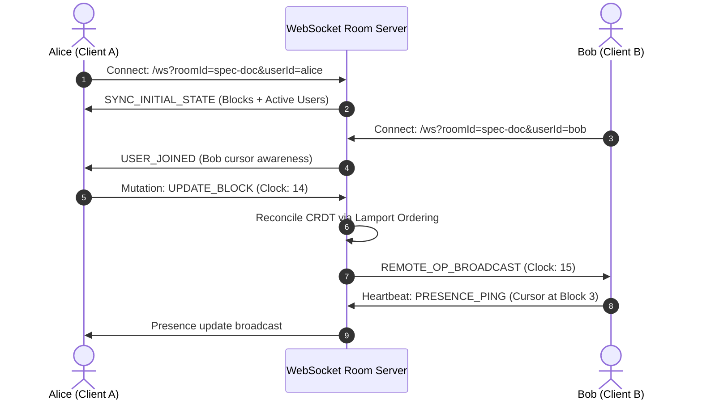

# Real-Time Collaborative Canvas Workspace

[](LICENSE)
[](https://www.typescriptlang.org)
[](https://github.com/websockets/ws)
[](#)
[](https://github.com/samaysawal24)

A distributed real-time collaborative document and canvas editor workspace powered by Block-Based Conflict-Free Replicated Data Types (CRDTs), Lamport logical timestamps, WebSocket synchronization, multi-cursor presence awareness, and markdown serialization.

---

## 🏛️ System Architecture



---

## 🚀 Key Features

- **Conflict-Free Replicated Data Types (CRDT):** Guarantees eventual consistency across concurrent block edits without locking.
- **Lamport Logical Timestamps:** Guarantees deterministic causality tracking and collision resolution across distributed clients.
- **Live Peer Presence Awareness:** Displays dynamic participant cursors, color badges, and heartbeats with automatic stale peer pruning.
- **Modular Block Architecture:** Supports rich blocks: Headings, Paragraphs, Code snippets, Bullet lists, and Callouts.
- **Native Markdown Exporter:** Generates sanitized Github-flavored markdown files on-the-fly.

---

## 📦 Project Structure

```
collab-canvas-workspace/
├── src/
│   ├── api/
│   │   └── routes.ts         # REST API for room snapshots & export
│   ├── crdt/
│   │   ├── blockState.ts     # Lamport clock CRDT document block engine
│   │   └── presence.ts       # Peer cursor and awareness manager
│   ├── types/
│   │   └── index.ts          # Block and operation schemas
│   ├── ws/
│   │   └── roomManager.ts    # WebSocket room router & broadcast hub
│   └── server.ts             # Express & WebSocket HTTP server
├── tests/
│   └── crdt_presence.test.ts # Jest test suite
├── Dockerfile                # Production container spec
├── docker-compose.yml        # Orchestration spec
├── tsconfig.json             # TypeScript compiler settings
├── package.json              # Dependencies and scripts
├── LICENSE                   # MIT License (smay)
└── README.md
```

---

## ⚡ Quickstart

### 1. Local Setup

```bash
git clone https://github.com/samaysawal24/collab-canvas-workspace.git
cd collab-canvas-workspace

npm install
```

### 2. Start Server

```bash
npm run dev
```

### 3. Connect via WebSocket

Connect your collaborative client to:
```
ws://localhost:3002?roomId=my-project-room&userId=user_123
```

### 4. Fetch Room Snapshot via REST
`GET /api/v1/rooms/my-project-room/snapshot`

### 5. Export Document to Markdown
`GET /api/v1/rooms/my-project-room/export/markdown`

---

## 🧪 Running Tests

```bash
npm test
```

---

## 📜 License & Author

- **Author:** smay ([@samaysawal24](https://github.com/samaysawal24))
- **Email:** cricketworldsamay@gmail.com
- **License:** Released under the [MIT License](LICENSE).

